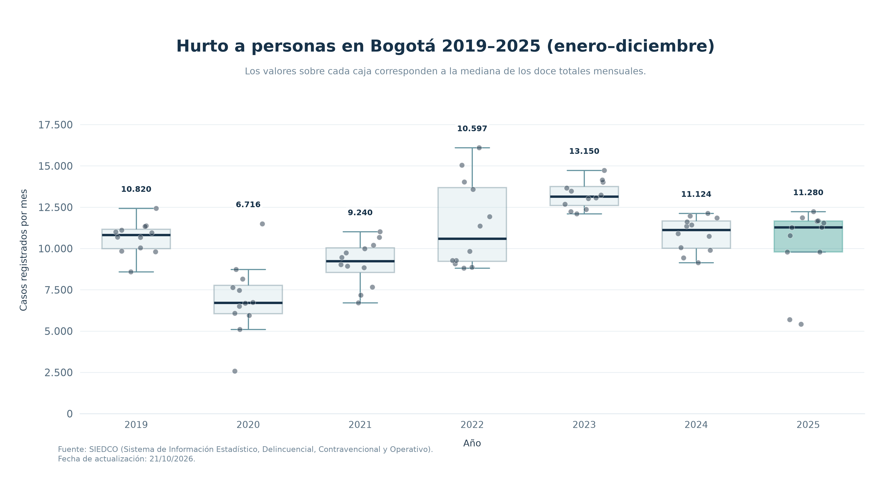
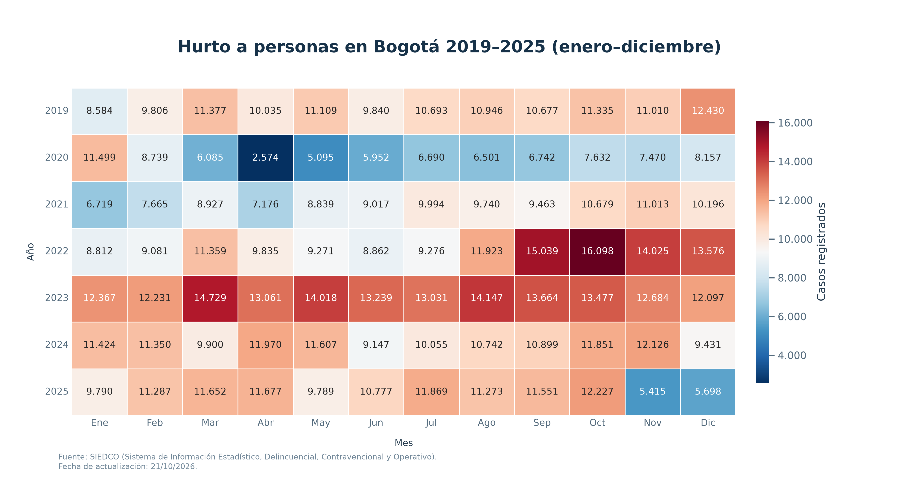
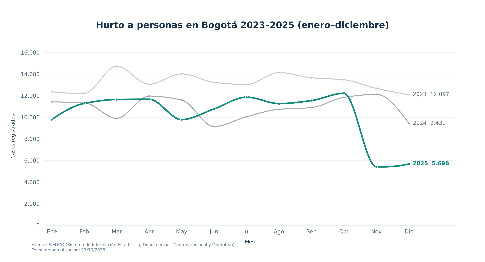

# Hurto a personas en Bogotá | 2019–2025

Análisis reproducible de la evolución mensual de los registros de hurto a personas en Bogotá. El proyecto consolida los datos por año y mes, valida la cobertura temporal y genera tres visualizaciones para comparar la distribución anual, la estacionalidad y los años recientes.

**English summary:** A reproducible Python analysis of monthly reported person-theft counts in Bogotá (2019–2025), with data validation and publication-ready visualizations.

## Qué contiene

- `analisis_hurto_bogota_2019_2025.ipynb`: recorrido documentado del análisis.
- `visualizaciones_hurto_bogota.py`: genera tres gráficos PNG a 300 dpi.
- `Hurto_a_personas.csv.gz`: CSV original comprimido para cumplir el límite de carga web de GitHub; pandas lo lee directamente.
- `scripts/prepare_data.py`: combina Excel anuales descargados de la fuente oficial para refrescar el CSV.
- `scripts/crear_documento_decisiones.py` y `docs/Justificacion_revision.docx`: soporte de las decisiones de diseño.
- `figures/`: resultados actuales para consulta rápida.

## Hallazgos descriptivos

- El extracto CSV contiene 214.690 filas de Bogotá para 2019–2025; se agregan los conteos de `Cantidad` por año y mes.
- La serie suma 869.815 registros reportados en el periodo. El total anual más alto de esta versión de los datos fue 158.745 en 2023.
- Cada año incluido tiene doce meses; se excluye 2026 para comparar periodos completos.

Los datos son conteos administrativos reportados: **no son tasas poblacionales** y, por sí solos, no prueban cambios en la incidencia real ni relaciones causales. La Policía advierte que las cifras pueden actualizarse.

## Visualizaciones

### Distribución de los doce totales mensuales por año

### Comparación de mes y año

### Estacionalidad en 2023, 2024 y 2025

## Reproducir

Requiere Python 3.10 o posterior.

1. Instala dependencias: `pip install -r requirements.txt`.
2. Ejecuta `python visualizaciones_hurto_bogota.py` para recrear las figuras en `salidas/`.
3. También puedes abrir el notebook en Jupyter y ejecutar sus celdas.

Para actualizar los datos: descarga los Excel anuales de 2019–2025 desde la [página de estadísticas delictivas de la Policía Nacional](https://www.policia.gov.co/delitos-de-impacto/hurto-personas), guárdalos en `data/raw/` y ejecuta `python scripts/prepare_data.py`. El preparador sobrescribe el CSV consolidado local; puedes comprimirlo con gzip para compartirlo.

## Método y controles

- Filtra Bogotá y los años 2019–2025; normaliza nombres de meses y suma `Cantidad` por mes.
- Comprueba campos esenciales, conteos enteros no negativos, doce meses por año, ausencia de duplicados en la agregación y conservación del total.
- Compara la mediana y dispersión de los doce totales mensuales, la distribución mes–año y los patrones mensuales de 2023–2025.
- Las curvas suavizadas solo interpolan entre puntos observados; los marcadores conservan los valores mensuales registrados.

## Fuente y notas

Fuente: Policía Nacional de Colombia, [Hurto a personas](https://www.policia.gov.co/delitos-de-impacto/hurto-personas), estadísticas extraídas de SIEDCO. La página oficial advierte que las cifras pueden variar y que su uso es estadístico. Fecha de actualización indicada para el extracto analizado: 21/10/2026.

El archivo `Hurto_a_personas.csv.gz` incluye el CSV comprimido para facilitar la reproducción y corresponde a datos publicados por la fuente indicada. Consulta las condiciones vigentes del portal antes de redistribuir o actualizar los datos. La licencia del código queda pendiente de definir por el autor.
